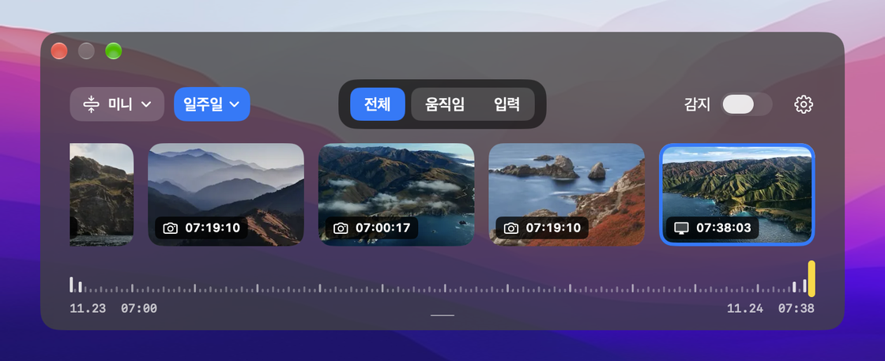

# 자리기록 (DeskTrace)

맥을 비울 때 감지를 켜 두면 카메라 앞의 움직임은 사진으로, 첫 키 입력이나 클릭은 그 순간의 화면으로 기록합니다. 돌아와서 기록을 시간순으로 훑어보세요. 이미지는 자신의 맥에만 저장됩니다.

**macOS 14 이상 · Apple Silicon 및 Intel 지원**

[자리기록 0.3.13 설치 파일 받기](https://github.com/sundaynighttt/desk-trace/releases/download/v0.3.13/DeskTrace-0.3.13.dmg) · [릴리스 기록](https://github.com/sundaynighttt/desk-trace/releases)


## 설치하고 감지 켜기

1. 위의 설치 파일(DMG)을 열고 **자리기록**을 **Applications(응용 프로그램)** 폴더로 끌어놓습니다.
2. 앱을 열고 오른쪽 위 **설정(톱니바퀴)**에서 카메라 움직임, 첫 입력 중 기록할 항목을 고릅니다. 움직임 사진의 촬영 간격은 10~60분 사이에서 1분 단위로 조정할 수 있습니다. 처음에는 10분입니다.
3. 자리를 비울 때 **감지**를 켜고 선택한 기능의 macOS 권한을 허용합니다. macOS가 재실행을 요청하면 앱을 다시 엽니다. 권한 문제로 감지가 꺼졌다면 스위치를 다시 켭니다.
4. 돌아오면 감지를 끄고 기록을 확인합니다. 감지 중에도 사진을 볼 수 있고, 창을 닫아도 메뉴 막대 아이콘으로 다시 열 수 있습니다.

## 무엇이 저장되나요?

| 켠 기능 | 기록하는 순간 | 저장되는 이미지 |
| --- | --- | --- |
| 카메라 움직임 | 카메라 앞의 움직임을 감지했을 때. 촬영 후 설정한 간격이 지나면 다음 움직임에서 다시 촬영합니다. | 그 순간의 카메라 사진 한 장 |
| 첫 입력 | 감지를 켠 뒤 처음으로 물리 키보드의 키를 누르거나 마우스·트랙패드를 클릭했을 때 | 기본 디스플레이의 화면 한 장 |

두 감지는 독립적으로 동작합니다. 촬영 대기 중 지나간 움직임은 대기 시간을 늘리지 않습니다. **감지**를 켜는 클릭은 첫 입력에서 제외하며, 한 번 화면을 저장하면 감지를 껐다 켜야 다음 첫 입력을 기록합니다.

모든 이미지는 원래 비율로 긴 변 최대 1024픽셀의 **WebP** 파일에 저장됩니다. **설정 → 저장 폴더 열기**에서 원본을 확인할 수 있습니다. 앱은 마이크 소리, 입력한 키 내용, 마우스 좌표를 기록하지 않습니다. 계정, 외부 전송, 휴대폰 알림 기능은 없습니다.

감지를 끄면 진행 중이던 촬영 결과도 폐기합니다. 창만 닫으면 감지가 계속되고, 앱을 종료하면 촬영이 멈춥니다. 다시 열면 마지막으로 켜 둔 감지를 이어갑니다. 새 버전으로 업데이트해도 같습니다. 직접 껐다면 다음 실행에서도 꺼져 있습니다. 이미 저장한 첫 입력은 다시 촬영하지 않고, 움직임 촬영의 남은 대기 시간도 이어집니다.

처음 설치하거나 **0.3.11 이하에서 처음 업데이트할 때**는 감지를 한 번 켜 주세요. 이전 버전에는 스위치 상태 기록이 없습니다. 두 감지 항목을 모두 꺼 둔 경우 감지 스위치를 누르면 항목을 선택할 수 있는 설정이 열립니다.

## 사진 찾아보기

앱을 실행하거나 닫았던 기록 창을 다시 열면 **일반 모드**에서 시작합니다. 왼쪽의 **온에어**는 현재 카메라 영상이며, 처음에는 카메라 접근 권한이 필요합니다. 감지는 오른쪽 스위치로 따로 켭니다. 왼쪽 위에서 언제든 **미니 · 일반**을 전환할 수 있습니다. 기본 조회 기간은 오늘을 포함한 최근 **일주일**입니다. **오늘 · 일주일 · 한달 · 전체** 중에서 기간을 고르고, 가운데 **전체 · 움직임 · 입력**에서 기록 종류를 고릅니다. 한달은 최근 30일이며 날짜는 맥의 현지 시각을 따릅니다. 모드를 전환해도 조회 조건과 감지 상태를 공유합니다.

| 사용법 | 미니 모드 | 일반 모드 |
| --- | --- | --- |
| 화면 구성 | 작은 사진 한 줄과 아래쪽 시간축. 처음에는 사진 한 줄에 맞는 최소 높이로 열립니다. | 왼쪽에 라이브 영상 또는 선택한 사진, 오른쪽에 날짜별 사진 목록과 세로 시간축이 있습니다. |
| 탐색 방향 | 왼쪽이 과거, 오른쪽이 최신입니다. 처음 열거나 필터를 바꾸면 최신 사진이 보입니다. | 위가 과거, 아래가 최신입니다. 스크롤하면 오른쪽 사진 목록만 움직입니다. |
| 기간과 촬영 시각 | 왼쪽 상단에서 기간을 고릅니다. 각 사진에 촬영 시각이 항상 보입니다. | 사진 목록 맨 위에서 기간을 고릅니다. 스크롤 중에도 해당 날짜가 남고, 각 사진 왼쪽 아래에 촬영 시각(시·분·초)이 항상 보입니다. |
| 사진 선택 | 사진을 클릭하면 원래 비율로 크게 열립니다. 아래 눈금을 가리키면 해당 기록이 보이고, 클릭하면 선택이 고정됩니다. 좌우 방향키로 이동할 수 있습니다. | 사진이나 눈금을 클릭하면 왼쪽에 해당 사진이 원래 비율로 표시됩니다. 사진 오른쪽 아래의 **라이브로 돌아가기**를 누르면 현재 카메라 영상으로 돌아갑니다. |

미니 모드에서는 노란 막대가 현재 보고 있는 기록을 가리킵니다. 일반 모드에서는 **짧은 흰색 눈금**이 선택한 사진을 가리키고, 라이브 화면에서는 조회 조건 안의 최신 기록을 가리킵니다. 사진과 시간축 사이는 12포인트이며, 양 끝의 월·일과 모든 눈금은 같은 왼쪽 선에서 시작합니다.

일반 모드의 라이브 영상은 카메라가 보내는 화면 비율로 표시합니다. 영상 오른쪽 위의 초록 점과 **온에어** 옆에는 카메라에서 받은 최신 영상의 월·일과 시·분·초가 보입니다. 영상 수신이 멎으면 시간이 더 흐르지 않고 **영상 대기**로 바뀝니다. 저장 사진을 선택하면 같은 자리에 **저장 사진**과 고정된 촬영 시각이 표시됩니다. **라이브로 돌아가기** 버튼은 사진 오른쪽 아래에 있습니다. 과거 사진을 보고 있는 동안 새 기록이 들어와도 선택한 사진과 목록 위치가 유지됩니다. 조회 조건을 바꿔 그 사진이 목록에서 빠지면 라이브로 돌아갑니다. 감지를 끄고 라이브만 볼 때는 저장하지 않으며, 카메라 권한이 없어도 저장된 사진은 열 수 있습니다.

<details>
<summary>미니 모드 화면 보기</summary>



</details>

<details>
<summary>화면 설계 기준</summary>

일반 모드의 오른쪽 저장 사진은 같은 창에서 0.3.0 사진 폭의 1/3에 가장 가까운 짝수 포인트로 표시합니다. 사진 높이는 저장된 원본의 가로·세로 비율에 맞춥니다. 960포인트 창에서 폭은 100포인트이고, 16:9 사진의 높이는 약 56포인트, 정사각형 사진은 100포인트입니다. 사진 목록의 기간 메뉴는 사진과 같은 폭의 24포인트 높이 줄입니다. 선택한 기간은 첫 날짜와 왼쪽을 맞추고 펼침 화살표는 오른쪽에 둡니다. 평소 배경은 투명하고, 포인터를 올리면 옅은 회색 배경이 나타납니다. 줄 전체를 눌러 기간을 선택합니다. 시간축의 날짜는 10포인트 고정폭 글꼴을 사용하고, 시간축 영역 오른쪽과 창 가장자리 사이에는 10포인트를 둡니다. 날짜는 맥의 현지 날짜별 묶음 맨 위에 한 번 표시합니다. 촬영 시각은 각 사진 왼쪽 아래의 작은 반투명 배경 위에 항상 표시합니다. 같은 날의 기록 사이에는 4포인트 간격을 둡니다.

가운데 필터의 어두운 배경에는 버튼 바깥으로 좌우 각각 10포인트, 위아래 각각 7포인트의 여백을 둡니다. 전체 버튼 옆에 움직임과 입력을 차례로 붙입니다. 움직임의 왼쪽 위·아래, 입력의 오른쪽 위·아래를 둥글게 하고 가운데 맞닿는 모서리는 직각으로 연결합니다. 미니 모드의 기본 창에는 약 7장의 사진이 보입니다. 상단 버튼과 사진, 사진과 물결 눈금 영역 사이의 간격은 각각 12포인트입니다. 미니 모드의 사진 줄과 하단 시간 눈금은 상단과 같은 25포인트의 좌우 여백을 사용합니다. 사진을 가리키면 파란 테두리가 생깁니다. 사진은 같은 간격으로 배치하고 시간 눈금은 실제 시간 간격을 따릅니다. 미니 모드로 전환하면 한 줄 높이에 맞춰지고, 이후 창 크기를 조절할 수 있습니다. 모드 버튼 왼쪽과 설정 버튼 오른쪽에 같은 여백을 둡니다. 배경은 어두운 반투명이고, 선택한 필터는 파란색, 나머지는 반투명 회색입니다. 시스템에서 투명도 줄이기를 켜면 단색 배경을 사용하고, 동작 줄이기를 켜면 시간 눈금의 물결 높이를 고정합니다. 빈 목록, 필터 결과 없음, 한 장, 같은 시각의 여러 기록을 모두 지원합니다.

</details>

## 권한과 저장 위치

| 기능 | 필요한 macOS 권한 |
| --- | --- |
| 라이브 보기, 카메라 움직임 사진 | 카메라 |
| 첫 키 입력·클릭 시 화면 저장 | 입력 모니터링, 화면 및 시스템 오디오 녹음(macOS 버전에 따라 화면 기록) |

같은 개발자 서명의 공식 설치 파일로 응용 프로그램 폴더의 앱을 업데이트하면 기존 macOS 권한은 일반적으로 유지됩니다. 앱은 감지를 다시 시작할 때 필요한 권한을 확인합니다. 권한이 변경되어 시작할 수 없으면 감지를 끄고 해당 설정을 안내합니다. 권한은 **시스템 설정 → 개인정보 보호 및 보안**에서 관리합니다. 앱은 오디오와 입력한 글자를 저장하지 않습니다. 이미지는 `~/Library/Application Support/DeskTrace/Captures/`에 저장하며 **설정 → 저장 폴더 열기**에서 확인할 수 있습니다.

## 주요 변경 기록

| 버전 | 변경 내용 |
| --- | --- |
| 0.1.0~0.2.1 · 초기 개발 | 로컬 촬영과 DMG 설치, 반투명 갤러리와 물결 시간축을 구현했습니다. |
| 0.2.2~0.2.5 | 0.2.2부터 설치 파일을 공개했습니다. 미니 창의 초기 높이와 시간 방향을 정리하고 노란 현재 위치 표시, 최근 일주일 기간 메뉴를 추가했습니다. |
| 0.3.0~0.3.3 | 라이브와 저장 사진을 함께 보는 일반 모드, 원본 비율의 작은 사진, 날짜별 묶음, 영상 위의 라이브 복귀 버튼을 추가했습니다. |
| 0.3.4~0.3.7 | 상단 필터를 정돈하고 모드 선택은 왼쪽 위로, 일반 모드의 기간 선택은 오른쪽 사진 목록 위로 옮겼습니다. |
| 0.3.8~0.3.9 | 일반 모드에서 사진을 가리킬 때만 시각을 표시하고, 세로 시간축 양 끝에는 날짜 한 줄을 두고 눈금을 왼쪽에 맞췄습니다. |
| 0.3.10 | 사진과 시간축 사이를 6포인트에서 12포인트로 늘렸습니다. 날짜 글자 끝과 창 오른쪽 가장자리 사이도 약 12포인트로 맞췄습니다. |
| 0.3.11 | 일반 모드의 온에어 화면으로 시작합니다. 저장 사진을 본 뒤 사진 오른쪽 아래의 **라이브로 돌아가기**로 온에어에 복귀할 수 있습니다. |
| 0.3.12 | 업데이트·재실행 뒤 감지 스위치와 진행 중인 촬영 대기를 복원합니다. |
| **0.3.13** | 일반 모드 썸네일에 촬영 시각을 항상 표시하고, 큰 화면 오른쪽 위에서 온에어 시계와 저장 사진의 촬영 시각을 구분합니다. |

0.2.2부터 공개한 버전별 설치 파일과 변경 내용은 [공개 릴리스 목록](https://github.com/sundaynighttt/desk-trace/releases)에서 확인할 수 있습니다.

## 소스에서 빌드

맥에서 Xcode 명령줄 도구, CMake를 준비한 뒤 프로젝트 루트에서 실행합니다.

```sh
./scripts/build.sh
./scripts/test.sh
./scripts/package.sh
```

빌드 시 공식 libwebp 소스를 내려받아 고정된 SHA-256 값을 확인합니다. 완성된 앱에는 인코더가 포함됩니다. 설치하는 맥에는 위 개발 도구가 필요하지 않습니다. 기본 산출물은 `.build/자리기록.app`과 `.build/DeskTrace-0.3.13.dmg`입니다. Apple Silicon과 Intel용 코드를 함께 포함합니다. 위 명령은 로컬 시험용 서명을 사용합니다. 공개 배포용 DMG는 빌드 후 `DESKTRACE_SIGN_IDENTITY`에 Developer ID Application 인증서를, `DESKTRACE_NOTARY_PROFILE`에 Apple 공증용 키체인 프로필 이름을 지정하고 `./scripts/release.sh`를 실행하면 생성됩니다. 스크립트는 앱과 DMG에 서명하고 Apple 공증을 받은 뒤 공증 확인표를 첨부해 검증합니다.

WebP 라이브러리의 저작권 및 특허 안내는 `Notices/`와 앱 번들의 Resources에 포함됩니다.
