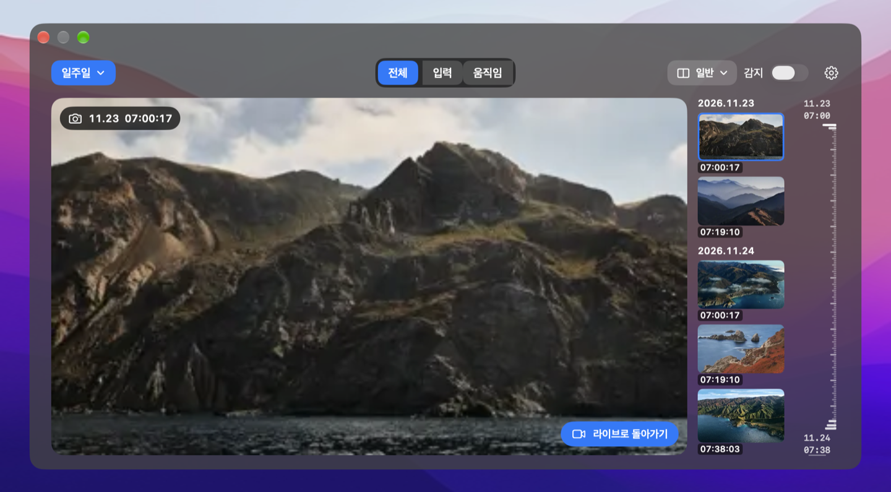

# 자리기록 (DeskTrace)

맥을 비울 때 감지를 켜 두면 카메라 앞의 움직임은 사진으로, 첫 키 입력이나 클릭은 그 순간의 화면으로 기록합니다. 돌아와서 기록을 시간순으로 훑어보세요. 이미지는 자신의 맥에만 저장됩니다.

**macOS 14 이상 · Apple Silicon 및 Intel 지원**

[자리기록 0.3.3 설치 파일 받기](https://github.com/sundaynighttt/desk-trace/releases/download/v0.3.3/DeskTrace-0.3.3.dmg) · [릴리스 기록](https://github.com/sundaynighttt/desk-trace/releases)



## 주요 기능

- 카메라 움직임과 첫 입력 감지를 각각 선택합니다. 카메라는 움직임 감지 또는 일반 모드의 라이브 보기 중에 사용하며 마이크는 사용하지 않습니다.
- 카메라 영상의 변화를 감지하면 사진 한 장을 저장합니다. 간격은 10~60분 사이 1분 단위이며 기본 10분입니다. 건너뛴 움직임은 대기를 연장하지 않습니다. 시간이 지나도 새 움직임이 있어야 촬영합니다.
- 첫 입력은 물리 키보드 또는 포인팅 기기의 클릭을 대상으로 합니다. 활성화 버튼 클릭은 제외합니다. 처음 입력이 들어온 시각에 기본 디스플레이 캡처를 요청합니다. 한 번 저장하면 같은 활성화 구간에서 다시 찍지 않습니다. 키 내용이나 마우스 좌표를 파일에 남기지 않습니다.
- 두 감지는 독립적입니다. 이미지는 긴 변 최대 1024픽셀, 원래 비율의 WebP로 저장합니다. 갤러리는 촬영 시각과 종류를 표시하며 사진을 클릭하면 크게 볼 수 있습니다.
- 감지를 끄면 진행 중인 촬영 결과도 폐기합니다. 창만 닫으면 켜 둔 감지를 유지하며 앱을 종료하면 중단합니다. 다시 실행하면 설정과 기록을 복원하고 감지는 꺼진 상태로 시작합니다.
- 사용자가 켠 감지 기능 또는 라이브 보기에 필요한 macOS 권한을 요청합니다. 휴대폰 알림·외부 전송·계정은 없습니다.

## 갤러리 사용법

갤러리를 처음 열면 왼쪽 기간 버튼에 **일주일**이 표시되고, 오늘을 포함한 최근 7일의 기록이 보입니다. 버튼을 누르면 **오늘 · 일주일 · 한달 · 전체** 중 하나를 선택할 수 있습니다. 가운데의 **전체 · 입력 · 움직임**은 선택한 기간 안에서 기록 종류를 고릅니다. 한달은 오늘을 포함한 최근 30일이고, 날짜는 맥의 현지 시각을 따릅니다.

- 오른쪽 상단의 모드 메뉴는 감지 스위치 바로 왼쪽에 있습니다. 기본값인 **미니**에서 **일반**을 선택하면 같은 창이 넓어집니다. 두 모드는 기간과 종류 필터, 감지 상태를 공유합니다.
- **일반 모드** 왼쪽에는 라이브 카메라, 오른쪽에는 저장 사진 한 열, 맨 오른쪽에는 세로 시간 눈금이 있습니다. 목록과 눈금 모두 위가 과거, 아래가 최신입니다. 스크롤하면 목록만 움직입니다. 사진이나 눈금을 클릭하면 왼쪽에 해당 사진을 크게 표시하며, **라이브로 돌아가기**를 누르면 현재 영상이 보입니다. 새 기록이 생겨도 보고 있던 과거 사진과 목록 위치를 유지합니다. 기간이나 종류를 바꿔 선택한 사진이 빠지면 라이브로 돌아갑니다.
- 일반 모드에서는 촬영 정보와 라이브 복귀 버튼이 영상·사진 안쪽에 겹쳐 표시됩니다. 일반 모드를 열 때 창 높이는 기본 16:9 영상의 표시 폭에 맞춰집니다. 라이브는 들어오는 영상 비율을 따르고, 저장 사진은 파일의 원본 비율로 전체 구도를 보여줍니다. 오른쪽 시간축의 짧은 흰색 눈금은 선택한 사진의 시각을 가리키고, 포인터 주변 눈금은 살짝 길어집니다. 라이브에서는 현재 필터의 최신 기록을 가리킵니다. 감지를 끄고 라이브만 볼 때는 사진을 저장하지 않습니다. 카메라 권한이 없어도 저장 사진을 열 수 있습니다.
- **미니 모드**는 사진 한 줄에 맞춘 최소 높이로 열립니다. 사진과 시간 눈금은 모두 왼쪽이 과거, 오른쪽이 최신입니다. 창을 열거나 필터를 바꾸면 해당 기간의 최신 사진이 보입니다. 두 모드 모두 사진의 촬영 시각을 항상 표시합니다. 미니 모드에서 사진을 가리키면 파란 테두리가 보이고, 클릭하면 원래 비율로 크게 볼 수 있습니다.
- 아래 시간 눈금 위에서 포인터를 움직이면 눈금이 물결처럼 솟고 해당 기록이 보입니다. 굵고 높은 노란 막대 하나가 현재 보고 있는 사진의 촬영 시각을 표시합니다. 창을 처음 열면 최신 사진의 시각을 가리키고, 기록이 없으면 표시되지 않습니다. 눈금을 클릭하면 선택이 고정되며 좌우 방향키로 인접 기록을 고를 수 있습니다. 사진은 같은 간격으로 놓이고 눈금은 실제 시간 간격을 나타냅니다.
- 오른쪽 위 설정에서 촬영 간격과 감지 종류를 바꾸거나 저장 폴더를 엽니다. 감지 중에도 기록을 조회할 수 있습니다.

<details>
<summary>화면 설계 기준</summary>

일반 모드의 오른쪽 저장 사진은 같은 창에서 0.3.0 사진 폭의 1/3에 가장 가까운 짝수 포인트로 표시합니다. 사진 높이는 저장된 원본의 가로·세로 비율에 맞춥니다. 960포인트 창에서 폭은 100포인트이고, 16:9 사진의 높이는 약 56포인트, 정사각형 사진은 100포인트입니다. 날짜는 맥의 현지 날짜별 묶음 맨 위에 한 번 표시합니다. 각 사진 바로 아래에는 촬영 시각(시:분:초)만 한 줄로 두고, 같은 날의 기록 사이에는 4포인트 간격을 둡니다.

가운데 필터는 더 어두운 배경 하나로 감쌉니다. 전체 버튼 옆에는 입력과 움직임을 차례로 붙이고, 두 버튼이 서로 마주 보는 모서리만 둥글게 합니다. 미니 모드의 기본 창에는 약 7장의 사진이 보입니다. 상단 버튼과 사진, 사진과 물결 눈금 영역 사이의 간격은 각각 12포인트입니다. 사진 줄과 시간 눈금의 좌우 여백은 상단과 같은 25포인트입니다. 지난번 창을 높게 늘려 두었어도 다음 실행에서는 한 줄 높이로 시작하며, 연 뒤에는 크기를 조절할 수 있습니다. 기간 버튼 왼쪽과 설정 버튼 오른쪽에 같은 여백을 둡니다. 배경은 어두운 반투명이고, 선택한 필터는 파란색, 나머지는 반투명 회색입니다. 시스템에서 투명도 줄이기를 켜면 단색 배경을 사용하고, 동작 줄이기를 켜면 시간 눈금의 물결 높이를 고정합니다. 빈 목록, 필터 결과 없음, 한 장, 같은 시각의 여러 기록을 모두 지원합니다.

</details>

## 설치와 첫 사용

1. 위 설치 파일(DMG)을 열고 **자리기록**을 **Applications(응용 프로그램)** 폴더로 끌어놓습니다.
2. 자리기록을 열고 오른쪽 위 **설정(톱니바퀴)**에서 사용할 감지를 선택합니다. 카메라 움직임의 촬영 간격은 10~60분입니다.
3. **감지** 스위치를 켜고 선택한 기능의 권한을 허용합니다. macOS가 재실행을 요청하면 앱을 다시 열고 감지를 켭니다.
4. 돌아오면 스위치를 끄고 사진을 확인합니다. 창을 닫아도 감지는 계속되며 메뉴 막대의 자리기록 아이콘에서 창을 다시 열 수 있습니다.

| 기능 | 필요한 macOS 권한 |
| --- | --- |
| 라이브 보기, 카메라 움직임 사진 | 카메라 |
| 첫 키 입력·클릭 시 화면 저장 | 입력 모니터링, 화면 및 시스템 오디오 녹음(macOS 버전에 따라 화면 기록) |

권한은 **시스템 설정 → 개인정보 보호 및 보안**에서 관리합니다. 앱은 오디오와 입력한 글자를 저장하지 않습니다. 이미지는 `~/Library/Application Support/DeskTrace/Captures/`에 저장하며 **설정 → 저장 폴더 열기**에서 확인할 수 있습니다.

## 빌드

맥에서 Xcode 명령줄 도구, CMake를 준비한 뒤 프로젝트 루트에서 실행합니다.

```sh
./scripts/build.sh
./scripts/test.sh
./scripts/package.sh
```

빌드 시 공식 libwebp 소스를 내려받아 고정된 SHA-256 값을 확인합니다. 완성된 앱에는 인코더가 포함됩니다. 설치하는 맥에는 위 개발 도구가 필요하지 않습니다. 기본 산출물은 `.build/자리기록.app`과 `.build/DeskTrace-0.3.3.dmg`입니다. Apple Silicon과 Intel용 코드를 함께 포함합니다. 위 명령은 로컬 시험용 서명을 사용합니다. 공개 배포용 DMG는 빌드 후 `DESKTRACE_SIGN_IDENTITY`에 Developer ID Application 인증서를, `DESKTRACE_NOTARY_PROFILE`에 Apple 공증용 키체인 프로필 이름을 지정하고 `./scripts/release.sh`를 실행하면 생성됩니다. 스크립트는 앱과 DMG에 서명하고 Apple 공증을 받은 뒤 공증 확인표를 첨부해 검증합니다.

WebP 라이브러리의 저작권 및 특허 안내는 `Notices/`와 앱 번들의 Resources에 포함됩니다.
